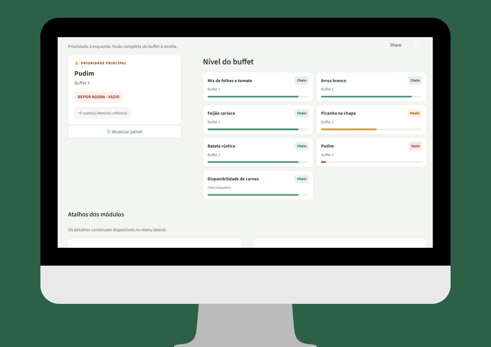
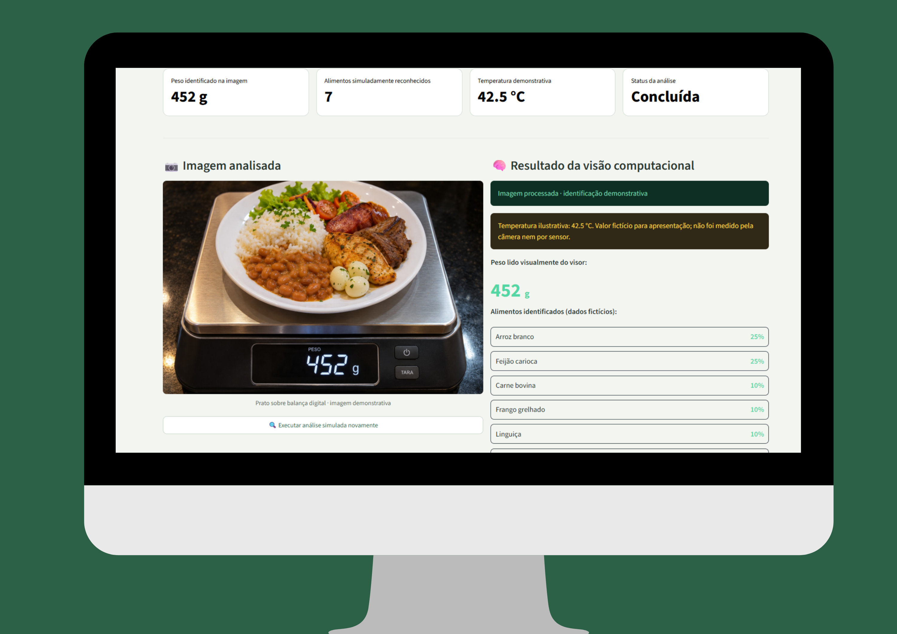
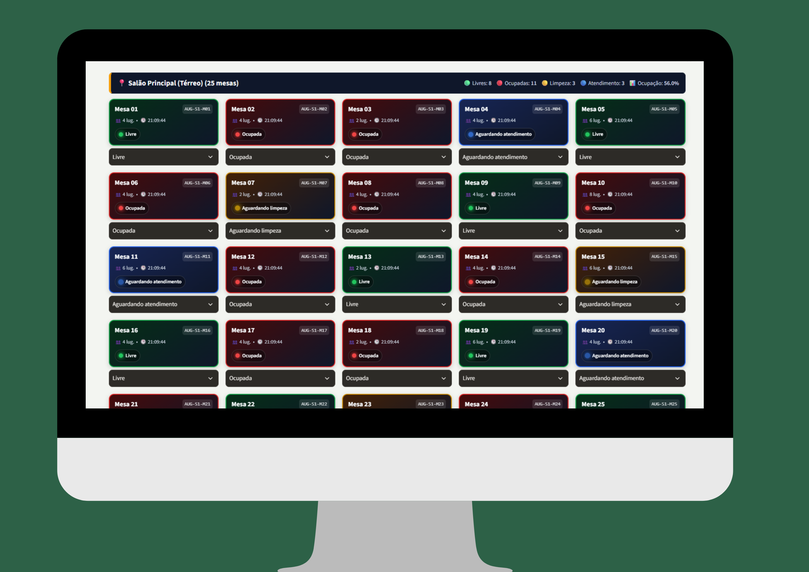

# Até a Primeira Garfada

**Inteligência operacional para transformar a experiência do restaurante.**

Hackathon FMU 2026.2

[Aplicação online](https://ate-primeira-garfada.streamlit.app/) · [Repositório](https://github.com/taticaires/ate_primeira_garfada) · [Apresentação em vídeo](https://youtu.be/euwbudI6EG0) · [Apresentação em slides (PDF)](docs/Até%20a%20Primeira%20Garfada_Apresentação%20Hackathon%202.2026%20FMU.pdf)

## Sobre o projeto

O Até a Primeira Garfada é um protótipo acadêmico de inteligência operacional aplicado ao contexto de restaurantes.

A proposta é reunir informações de diferentes etapas da operação em uma interface integrada, facilitando a leitura de indicadores, a identificação de situações que merecem atenção e o apoio à tomada de decisão.

O projeto explora como tecnologia e visualização de dados podem contribuir para a organização da operação, do buffet ao atendimento e à gestão de mesas.

A visão do projeto vai além do painel digital: propõe conectar a coleta de dados, o apoio à equipe e a comunicação com o cliente ao longo de toda a jornada no restaurante. Algumas iniciativas são pensadas como implementações práticas de curto prazo, enquanto a integração com câmeras, visão computacional e fontes de dados reais representa uma etapa de evolução e validação.

## A jornada do cliente e da operação

A proposta considera a experiência completa, da chegada à saída:

1. **Chegada e escolha:** totens ou painéis visuais no salão apresentam o prato do dia e outras opções do cardápio. A comunicação busca despertar o interesse por diferentes preparações, não apenas pelo churrasco, e orientar a escolha do cliente.
2. **Identificação de mesas:** uma sinalização luminosa discreta pode indicar mesas livres para os clientes e facilitar a identificação, pela equipe, de mesas ocupadas, em atendimento ou que precisam de limpeza.
3. **Serviço e buffet:** câmeras e recursos de visão computacional poderão apoiar a leitura do fluxo no salão e a observação dos níveis do buffet, gerando sinais para organização e reposição.
4. **Montagem do prato:** a balança inteligente poderá combinar a leitura do peso com análise visual dos alimentos, apoiando estimativas de composição e consumo.
5. **Consumo e retorno dos pratos:** a análise visual do retorno dos pratos poderá contribuir para estimar sobras e padrões de desperdício, respeitando a necessidade de validação em ambiente real.
6. **Saída e avaliação:** um totem de avaliação rápida permite que o cliente registre sua percepção do atendimento com poucos toques. Esse retorno pode ser relacionado aos indicadores operacionais para compreender melhor a experiência.

## Problema identificado

Em restaurantes, informações de diferentes etapas da operação podem ficar distribuídas entre setores e controles independentes. Essa fragmentação pode dificultar a visualização do funcionamento geral, a identificação de gargalos e o acompanhamento de reposição, ocupação e desperdício.

## Solução proposta

O protótipo reúne módulos operacionais em uma aplicação com navegação integrada. A Visão Geral apresenta um resumo demonstrativo e sinais visuais de atenção, enquanto os módulos permitem consultar diferentes dimensões da operação.

**Fluxo conceitual:** informações operacionais → visualização integrada → identificação de prioridades → apoio à decisão.

## Módulos

- **Visão Geral:** painel central com indicadores resumidos e alertas operacionais.
- **Balança Inteligente:** demonstração visual relacionada à pesagem e à análise ilustrativa do prato.
- **Monitoramento do Buffet:** níveis demonstrativos dos alimentos e indicação de reposição.
- **Fluxo e Atendimento:** visualização demonstrativa do fluxo e do atendimento.
- **Gestão de Mesas:** estados e ocupação demonstrativa das mesas.
- **Desperdício e Experiência:** dados demonstrativos relacionados ao consumo, descarte e experiência do cliente.

## Capturas de tela

As imagens apresentam interfaces do protótipo. Os dados exibidos são simulados para fins de demonstração.

### Visão Geral

Painel central com indicadores resumidos e alerta operacional.


### Monitoramento do Buffet

Visualização dos níveis dos alimentos e da prioridade de reposição.



### Balança Inteligente

Demonstração visual da pesagem e da análise ilustrativa do prato.



### Desperdício e Experiência

Gráficos demonstrativos de consumo, descarte e experiência do cliente.


### Gestão de Mesas

Visualização dos estados e da ocupação demonstrativa das mesas.



## Materiais de apresentação

- **Vídeo:** [Assistir à apresentação da solução](https://youtu.be/euwbudI6EG0)
- **Slides:** [Abrir apresentação em PDF](docs/Até%20a%20Primeira%20Garfada_Apresentação%20Hackathon%202.2026%20FMU.pdf)
- **Aplicação:** [Acessar o protótipo online](https://ate-primeira-garfada.streamlit.app/)

## Tecnologias utilizadas

- Python
- Streamlit
- Pandas
- Altair
- JSON

## Organização do repositório

```text
ate_primeira_garfada/
├── app.py
├── README.md
├── docs/
│   ├── images/                 # Capturas de tela do protótipo
│   └── apresentação.pdf        # Slides do Hackathon
└── modulos/
    ├── atendimento/
    ├── balanca_inteligente/
    ├── monitoramento_buffet/
    ├── gestao_mesas/
    └── desperdicio/
```

A aplicação principal organiza o acesso aos módulos. Os diretórios dos módulos contêm suas interfaces e, quando aplicável, arquivos JSON com dados demonstrativos.

## Como executar localmente

Pré-requisitos: Python instalado. Git é necessário para clonar o repositório.

1. Clone o projeto:

   ```bash
   git clone https://github.com/taticaires/ate_primeira_garfada.git
   ```

2. Acesse a pasta:

   ```bash
   cd ate_primeira_garfada
   ```

3. Instale as dependências principais:

   ```bash
   pip install streamlit pandas altair
   ```

4. Inicie a aplicação:

   ```bash
   python -m streamlit run app.py
   ```

A aplicação será aberta no navegador. Utilize o menu lateral para navegar entre os módulos.

## Escopo e limitações

Este projeto foi desenvolvido como protótipo acadêmico para demonstração e avaliação. Os dados apresentados são simulados ou demonstrativos e não representam resultados medidos em uma operação real.

Nesta versão, não há integração ativa com sensores físicos, balanças inteligentes ou sistemas operacionais reais do restaurante. A análise da balança é ilustrativa, baseada em imagem e dados fictícios.

## Caminho de implementação

A evolução está organizada em duas frentes complementares.

### Melhorias práticas de curto prazo

- Implantar comunicação visual no salão, com destaque para o prato do dia e opções do cardápio;
- Testar sinalização discreta nas mesas para apoiar a identificação de disponibilidade e necessidade de limpeza;
- Disponibilizar um totem de avaliação rápida na saída;
- Usar os retornos dos clientes e observações da equipe para aprimorar a operação.

### Evolução tecnológica

- Integrar câmeras e fontes de dados para leitura de fluxo e apoio ao monitoramento;
- Desenvolver e validar a análise visual do buffet, da balança e do retorno dos pratos;
- Integrar sensores e dados reais, quando disponíveis;
- Aprimorar indicadores, regras de análise e conexão entre módulos;
- Validar a solução em ambiente operacional e avaliar seus efeitos sobre fluxo, desperdício e experiência.

As iniciativas descritas são propostas de implementação e evolução. Não estão apresentadas como integrações já concluídas ou resultados comprovados nesta versão acadêmica.

## Créditos

Projeto desenvolvido por:

- **Luciene Ap. Oliveira**
- **Tatiane A. Caires**
- **André Luis N. Romão**

Hackathon FMU 2026.2.

[Aplicação online](https://ate-primeira-garfada.streamlit.app/) · [Repositório GitHub](https://github.com/taticaires/ate_primeira_garfada) · [Vídeo](https://youtu.be/euwbudI6EG0) · [Slides em PDF](docs/Até%20a%20Primeira%20Garfada_Apresentação%20Hackathon%202.2026%20FMU.pdf)
