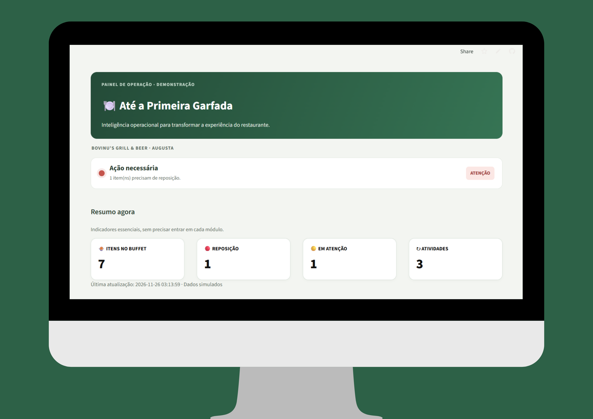

# Até a Primeira Garfada

**Inteligência operacional para transformar a experiência do restaurante.**

Hackathon FMU 2026.2

[Aplicação online](https://ate-primeira-garfada.streamlit.app/) · [Repositório](https://github.com/taticaires/ate_primeira_garfada)

## Sobre o projeto

O Até a Primeira Garfada é um protótipo acadêmico de inteligência operacional aplicado ao contexto de restaurantes.

A proposta é reunir informações de diferentes etapas da operação em uma interface integrada, facilitando a leitura de indicadores, a identificação de situações que merecem atenção e o apoio à tomada de decisão.

O projeto explora como tecnologia e visualização de dados podem contribuir para a organização da operação, do buffet ao atendimento e à gestão de mesas.

## Problema identificado

Em restaurantes, informações de diferentes etapas da operação podem ficar distribuídas entre setores e controles independentes. Essa fragmentação pode dificultar a visualização do funcionamento geral, a identificação de gargalos e o acompanhamento de reposição, ocupação e desperdício.

## Solução proposta

O protótipo reúne módulos operacionais em uma aplicação com navegação integrada. A Visão Geral apresenta um resumo demonstrativo e sinais visuais de atenção, enquanto os módulos permitem consultar diferentes dimensões da operação.

**Fluxo conceitual:** informações operacionais → visualização integrada → identificação de prioridades → apoio à decisão.

## Módulos

- **Visão Geral:** painel central com indicadores resumidos e alertas operacionais.
- **Balança Inteligente:** demonstração visual relacionada à pesagem e à análise ilustrativa do prato.
- **Monitoramento do Buffet:** níveis demonstrativos dos alimentos e indicação de reposição.
- **Fluxo e Atendimento:** visualização demonstrativa do fluxo e do atendimento.
- **Gestão de Mesas:** estados e ocupação demonstrativa das mesas.
- **Desperdício e Experiência:** dados demonstrativos relacionados ao consumo, descarte e experiência do cliente.

## Capturas de tela

As imagens apresentam interfaces do protótipo. Os dados exibidos são simulados para fins de demonstração.

### Visão Geral

Painel central com indicadores resumidos e alerta operacional.



### Monitoramento do Buffet

Visualização dos níveis dos alimentos e da prioridade de reposição.


### Balança Inteligente

Demonstração visual da pesagem e da análise ilustrativa do prato.


### Desperdício e Experiência

Gráficos demonstrativos de consumo, descarte e experiência do cliente.


### Gestão de Mesas

Visualização dos estados e da ocupação demonstrativa das mesas.


## Vídeo de demonstração

Vídeo de apresentação da solução prática, com duração de até 2 minutos:

**[Inserir link do vídeo]**

## Apresentação final

Apresentação do projeto em até 5 slides:

**[Inserir link dos slides]**

## Tecnologias utilizadas

- Python
- Streamlit
- Pandas
- Altair
- JSON

## Organização do repositório

```text
ate_primeira_garfada/
├── app.py
└── modulos/
    ├── atendimento/
    ├── balanca_inteligente/
    ├── monitoramento_buffet/
    ├── gestao_mesas/
    └── desperdicio/
```

A aplicação principal organiza o acesso aos módulos. Os diretórios dos módulos contêm suas interfaces e, quando aplicável, arquivos JSON com dados demonstrativos.

## Como executar localmente

Pré-requisitos: Python instalado. Git é necessário para clonar o repositório.

1. Clone o projeto:

   ```bash
   git clone https://github.com/taticaires/ate_primeira_garfada.git
   ```

2. Acesse a pasta:

   ```bash
   cd ate_primeira_garfada
   ```

3. Instale as dependências principais:

   ```bash
   pip install streamlit pandas altair
   ```

4. Inicie a aplicação:

   ```bash
   python -m streamlit run app.py
   ```

A aplicação será aberta no navegador. Utilize o menu lateral para navegar entre os módulos.

## Escopo e limitações

Este projeto foi desenvolvido como protótipo acadêmico para demonstração e avaliação. Os dados apresentados são simulados ou demonstrativos e não representam resultados medidos em uma operação real.

Nesta versão, não há integração ativa com sensores físicos, balanças inteligentes ou sistemas operacionais reais do restaurante. A análise da balança é ilustrativa, baseada em imagem e dados fictícios.

## Próximas etapas

- Integrar sensores e fontes de dados reais;
- Validar a solução em ambiente operacional;
- Evoluir indicadores e regras de análise;
- Ampliar a integração entre módulos;
- Avaliar o impacto sobre o fluxo, o desperdício e a experiência do cliente.

## Créditos

Projeto desenvolvido por **Tatiane Caires | Luciene Oliveira | André Romão** para o Hackathon FMU 2026.2.

[Aplicação online](https://ate-primeira-garfada.streamlit.app/) · [Repositório GitHub](https://github.com/taticaires/ate_primeira_garfada)
