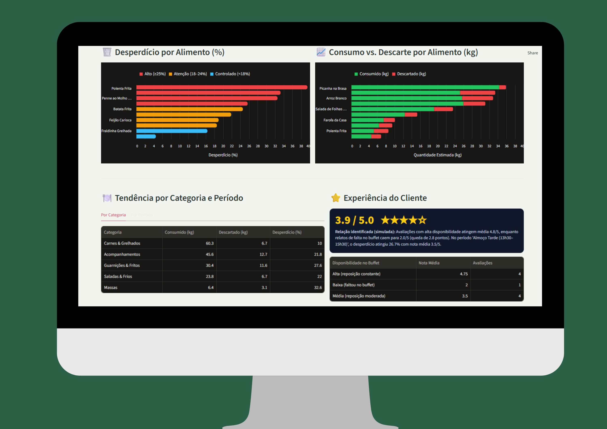

# Até a Primeira Garfada

**Inteligência operacional para transformar a experiência do restaurante.**

Hackathon FMU 2026.2

[Aplicação online](https://ate-primeira-garfada.streamlit.app/) · [Repositório](https://github.com/taticaires/ate_primeira_garfada) · [Apresentação em vídeo](https://youtu.be/euwbudI6EG0) · [Apresentação em slides (PDF)](docs/Até%20a%20Primeira%20Garfada_Apresentação%20Hackathon%202.2026%20FMU.pdf)

## Sobre o projeto

O **Até a Primeira Garfada** é um protótipo acadêmico de inteligência operacional aplicado a restaurantes. Sua proposta é ajudar o estabelecimento a **compreender melhor a operação, identificar perdas e melhorar a experiência do cliente**, desde a chegada até o momento em que ele consegue começar a refeição.

O projeto parte de duas dores que se encontram no dia a dia: para o restaurante, desperdício e dificuldade de enxergar onde estão os gargalos; para o consumidor, filas que atrasam a refeição e podem fazer a comida esfriar antes da primeira garfada.

A solução propõe reunir sinais operacionais em uma central visual, transformando dados em informações que apoiem a análise e a tomada de decisão. A tecnologia é o meio para compreender os problemas, não uma mudança que precisa ser implantada inteira de uma só vez.

O protótipo demonstra essa ideia em uma aplicação integrada. Comunicação visual sobre o prato do dia, organização do fluxo e coleta de feedback são exemplos de melhorias práticas consideradas na proposta. Integrações com câmeras, visão computacional, sensores e fontes reais de dados fazem parte da evolução futura e precisam ser conectadas e validadas.

## A jornada do cliente e da operação

A proposta considera a experiência completa, da chegada à saída:

1. **Chegada e escolha:** totens ou painéis visuais no salão apresentam o prato do dia e outras opções do cardápio. A comunicação busca despertar o interesse por diferentes preparações, não apenas pelo churrasco, e orientar a escolha do cliente.
2. **Identificação de mesas:** uma sinalização luminosa discreta pode indicar mesas livres para os clientes e facilitar a identificação, pela equipe, de mesas ocupadas, em atendimento ou que precisam de limpeza.
3. **Fluxo do salão e churrasqueira:** câmeras poderão acompanhar o fluxo e o tempo de espera na área da churrasqueira, identificando períodos de fila. Como referência inicial de observação, foi proposto acompanhar um intervalo de até **2 minutos e 30 segundos por cliente**. Esse parâmetro é uma hipótese de trabalho a ser validada, não um padrão operacional comprovado. Quando esse intervalo for ultrapassado de forma recorrente, um alerta poderá aparecer no painel para que o gerente avalie a causa e decida a ação adequada, como reorganizar o fluxo ou considerar reforço de equipe.
4. **Buffet:** câmeras e recursos de visão computacional poderão observar os níveis dos alimentos e gerar sinais para organização e reposição.
5. **Montagem do prato:** a balança inteligente poderá combinar a leitura do peso com análise visual dos alimentos, apoiando estimativas de composição e consumo.
6. **Consumo e retorno dos pratos:** a análise visual do retorno dos pratos poderá contribuir para estimar sobras e padrões de desperdício, respeitando a necessidade de validação em ambiente real.
7. **Saída e avaliação:** um totem de avaliação rápida permite que o cliente registre sua percepção do atendimento com poucos toques. Esse retorno pode ser relacionado aos indicadores operacionais para compreender melhor a experiência.

## As dores que motivam o projeto

**Para o restaurante**, o consumo desbalanceado de itens de maior custo, como a carne, e o desperdício no buffet podem comprometer a margem. Sem informações organizadas, torna-se mais difícil compreender quando e onde essas perdas acontecem e quais mudanças realmente podem ajudar.

**Para o consumidor**, a fila, especialmente na churrasqueira, pode prolongar o tempo entre montar o prato e sentar-se para comer. A espera afeta o fluxo do salão e pode comprometer a temperatura e a qualidade percebida da refeição.

Um relato real recebido de um consumidor ilustra essa situação:

> “Entre fazer o prato e sentar pra comer, já esfriou a comida.”

O comentário é apresentado como uma percepção individual, não como resultado de pesquisa ou dado estatístico. Ele ajuda a traduzir uma questão operacional em uma experiência concreta: uma refeição que começa depois de uma espera frustrante.

## Como os dados apoiam decisões

O projeto parte de uma premissa: **decisões operacionais de maior impacto devem ser orientadas por dados, não por suposições.** A central proposta reúne informações sobre consumo, desperdício, reposição, fluxo e experiência do cliente para ajudar o gestor a identificar padrões, compreender gargalos e avaliar oportunidades de melhoria.

O sistema não toma decisões automaticamente nem impõe mudanças à operação. Ele oferece uma leitura organizada para que o gestor decida, com mais contexto, o que precisa ser feito. As primeiras iniciativas podem ser simples e graduais; decisões de maior impacto devem considerar dados observados e validados no ambiente real.

Por exemplo, não seria adequado recomendar a contratação de cinco funcionários sem conhecer a demanda, os horários de maior movimento, a distribuição das tarefas e os gargalos existentes. O acompanhamento do tempo de espera na churrasqueira, usando como referência proposta até 2 minutos e 30 segundos por cliente, pode ajudar a identificar períodos críticos. Se o tempo exceder essa referência, o painel poderá sinalizar a situação ao gerente. A análise pode indicar que é necessário reforçar a equipe, mas também pode revelar que uma reorganização do fluxo ou das tarefas resolve o problema. O sistema apoia essa avaliação; a decisão continua sendo do gestor.

## Solução proposta

O protótipo reúne módulos operacionais em uma aplicação com navegação integrada. A Visão Geral apresenta um resumo demonstrativo e sinais visuais de atenção, enquanto os módulos permitem consultar diferentes dimensões da operação.

**Fluxo conceitual:** informações operacionais → visualização integrada → identificação de prioridades → apoio à decisão.

## Módulos

- **Visão Geral:** painel central com indicadores resumidos e alertas operacionais.
- **Balança Inteligente:** demonstração visual relacionada à pesagem , sensor de temperatura e à análise ilustrativa do prato.
- **Monitoramento do Buffet:** níveis demonstrativos dos alimentos e indicação de reposição.
- **Fluxo e Atendimento:** visualização demonstrativa do fluxo, atendimento e acompanhamento proposto do tempo de espera na churrasqueira, com referência de 2 minutos e 30 segundos e sinalização de possíveis gargalos para análise gerencial.
- **Gestão de Mesas:** estados e ocupação demonstrativa das mesas.
- **Desperdício e Experiência:** dados demonstrativos relacionados ao consumo, descarte e experiência do cliente.

## Capturas de tela

As imagens apresentam interfaces do protótipo. Os dados exibidos são simulados para fins de demonstração.

### Visão Geral

Painel central com indicadores resumidos e alerta operacional.


### Monitoramento do Buffet

Visualização dos níveis dos alimentos e da prioridade de reposição.


### Balança Inteligente

Demonstração visual da pesagem e da análise ilustrativa do prato.


### Desperdício e Experiência

Gráficos demonstrativos de consumo, descarte e experiência do cliente.



### Gestão de Mesas

Visualização dos estados e da ocupação demonstrativa das mesas.


## Materiais de apresentação

- **Vídeo:** [Assistir à apresentação da solução](https://youtu.be/euwbudI6EG0)
- **Slides:** [Abrir apresentação em PDF](docs/Até%20a%20Primeira%20Garfada_Apresentação%20Hackathon%202.2026%20FMU.pdf)
- **Aplicação:** [Acessar o protótipo online](https://ate-primeira-garfada.streamlit.app/)

## Tecnologias utilizadas

- Python
- Streamlit
- Pandas
- Altair
- JSON

## Organização do repositório

```text
ate_primeira_garfada/
├── app.py
├── README.md
├── docs/
│   ├── images/                 # Capturas de tela do protótipo
│   └── apresentação.pdf        # Slides do Hackathon
└── modulos/
    ├── atendimento/
    ├── balanca_inteligente/
    ├── monitoramento_buffet/
    ├── gestao_mesas/
    └── desperdicio/
```

A aplicação principal organiza o acesso aos módulos. Os diretórios dos módulos contêm suas interfaces e, quando aplicável, arquivos JSON com dados demonstrativos.

## Como executar localmente

Pré-requisitos: Python instalado. Git é necessário para clonar o repositório.

1. Clone o projeto:

   ```bash
   git clone https://github.com/taticaires/ate_primeira_garfada.git
   ```

2. Acesse a pasta:

   ```bash
   cd ate_primeira_garfada
   ```

3. Instale as dependências principais:

   ```bash
   pip install streamlit pandas altair
   ```

4. Inicie a aplicação:

   ```bash
   python -m streamlit run app.py
   ```

A aplicação será aberta no navegador. Utilize o menu lateral para navegar entre os módulos.

## Escopo e limitações

Este projeto foi desenvolvido como protótipo acadêmico para demonstração e avaliação. Os dados apresentados são simulados ou demonstrativos e não representam resultados medidos em uma operação real.

Nesta versão, não há integração ativa com sensores físicos, balanças inteligentes ou sistemas operacionais reais do restaurante. A análise da balança é ilustrativa, baseada em imagem e dados fictícios.

## Caminho de implementação

A evolução está organizada em duas frentes complementares.

### Melhorias práticas de curto prazo

- Implantar comunicação visual no salão, com destaque para o prato do dia e opções do cardápio;
- Testar sinalização discreta nas mesas para apoiar a identificação de disponibilidade e necessidade de limpeza;
- Disponibilizar um totem de avaliação rápida na saída;
- Usar os retornos dos clientes e observações da equipe para aprimorar a operação.

### Evolução tecnológica

- Integrar câmeras e fontes de dados para leitura do fluxo do salão, acompanhamento das filas na churrasqueira e apoio ao monitoramento;
- Desenvolver e validar a análise visual do buffet, da balança e do retorno dos pratos;
- Integrar sensores e dados reais, quando disponíveis;
- Aprimorar indicadores, regras de análise e conexão entre módulos, incluindo alertas de tempo de espera na churrasqueira;
- Validar a solução em ambiente operacional e avaliar seus efeitos sobre fluxo, desperdício e experiência.

As iniciativas descritas são propostas de implementação e evolução. Não estão apresentadas como integrações já concluídas ou resultados comprovados nesta versão acadêmica.

## Créditos

Projeto desenvolvido por:

- **Luciene Ap. Oliveira**
- **Tatiane A. Caires**
- **André Luis N. Romão**

Hackathon FMU 2026.2.

[Aplicação online](https://ate-primeira-garfada.streamlit.app/) · [Repositório GitHub](https://github.com/taticaires/ate_primeira_garfada) · [Vídeo](https://youtu.be/euwbudI6EG0) · [Slides em PDF](docs/Até%20a%20Primeira%20Garfada_Apresentação%20Hackathon%202.2026%20FMU.pdf)
